 

 

## `[01] whoami`

| | |
|:--|:--|
| **Role** | Full Stack Developer |
| **Focus** | Backend · REST APIs · Web Applications |
| **Location** | Caraguatatuba, SP — Brazil |
| **Portfolio** | [jeanbrito.vercel.app](https://jeanbrito.vercel.app/) |

> I build modern web applications with an emphasis on the **backend**, designing **REST APIs** and combining frontend and backend into complete products — always with **clean**, **organized** and **scalable** code.

 

## `[02] stack`

 

## `[03] projects`

<table width="100%">
<tr>
<td width="50%" valign="top">

**[portfolio](https://github.com/jeanbrito-dev/portfolio)** 
Personal site — frontend/backend integration and REST APIs. 
`JavaScript` · `React` · `Node.js` · `Express` · `SQL`

</td>
<td width="50%" valign="top">

**[city-backend](https://github.com/jeanbrito-dev/city-backend)** 
Backend API and services for the City project. 
`JavaScript` · `Node.js` · `Express`

</td>
</tr>
<tr>
<td width="50%" valign="top">

**[city-frontend](https://github.com/jeanbrito-dev/city-frontend)** 
Web interface for the City project, consuming the backend API. 
`JavaScript` · `React`

</td>
<td width="50%" valign="top">

**[ecotube](https://github.com/jeanbrito-dev/ecotube)** 
Entertainment site for environmental education — young people, teachers and students. 
`HTML` · `CSS` · `JavaScript`

</td>
</tr>
</table>

 

## `[04] stats`

  

<samp>// end of file</samp>

