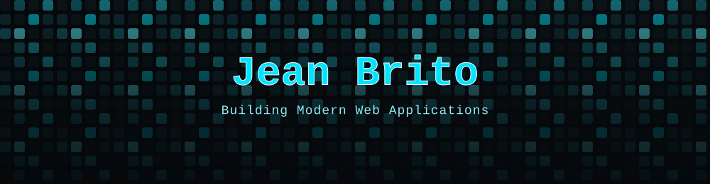

<div align="center">



<br>

<a href="https://jeanbrito.vercel.app/"></a>
<a href="https://github.com/jeanbrito-dev"></a>
<a href="https://www.linkedin.com/in/jean-brito-dev"></a>

<br><br>


<br>




</div>

<br>

## `~/about`

```ts
const brito = {
  role: "Full Stack Developer",
  focus: ["Backend", "REST APIs", "Web Applications"],
  location: "Caraguatatuba, SP — Brazil",
  stack: {
    frontend: ["React", "TypeScript", "Tailwind CSS"],
    backend: ["Node.js", "Express", "Prisma"],
    data: ["MongoDB", "Firebase", "PostgreSQL", "MySQL"],
  },
  principles: ["clean", "organized", "scalable"],
  mission: "build software that solves real-world problems",
} as const;
```

I build modern web applications with an emphasis on the **backend**: designing **REST APIs** and shipping complete products by combining frontend and backend, always keeping the code **clean**, **organized** and **scalable**.

<div align="center"></div>

## `~/stack`

<div align="center">

<table>
<tr>
<td align="right"><b>Frontend</b></td>
<td></td>
</tr>
<tr>
<td align="right"><b>Backend</b></td>
<td></td>
</tr>
<tr>
<td align="right"><b>Databases</b></td>
<td></td>
</tr>
<tr>
<td align="right"><b>Tools</b></td>
<td></td>
</tr>
</table>

</div>

<div align="center"></div>

## `~/projects`

<table align="center" width="100%">
<tr>
<td width="50%" valign="top">

### [portfolio](https://github.com/jeanbrito-dev/portfolio)
Personal site: full stack developer focused on backend — modern web applications, REST APIs and frontend/backend integration.

    

</td>
<td width="50%" valign="top">

### [city-backend](https://github.com/jeanbrito-dev/city-backend)
Backend API and services for the City project.

  

</td>
</tr>
<tr>
<td width="50%" valign="top">

### [city-frontend](https://github.com/jeanbrito-dev/city-frontend)
Web interface for the City project, consuming the backend API.

 

</td>
<td width="50%" valign="top">

### [ecotube](https://github.com/jeanbrito-dev/ecotube)
Entertainment website focused on environmental education for young people, teachers and students.

  

</td>
</tr>
</table>

<div align="center"></div>

## `~/stats`

<div align="center">


<br><br>


<br>

<picture>
  <source media="(prefers-color-scheme: dark)" srcset="https://raw.githubusercontent.com/jeanbrito-dev/jeanbrito-dev/output/github-snake-dark.svg" />
  <source media="(prefers-color-scheme: light)" srcset="https://raw.githubusercontent.com/jeanbrito-dev/jeanbrito-dev/output/github-snake.svg" />
  
</picture>

</div>

<br>

## `~/connect`

<div align="center">

<a href="https://www.linkedin.com/in/jean-brito-dev"></a>
<a href="https://jeanbrito.vercel.app/"></a>

</div>

