

<picture><source media="(prefers-color-scheme: dark)" srcset="./assets/dark/hero.svg"></picture>

<a href="https://jeanbrito.vercel.app/"><picture><source media="(prefers-color-scheme: dark)" srcset="./assets/dark/links/portfolio.svg"></picture></a>
<a href="https://www.linkedin.com/in/jean-brito-dev"><picture><source media="(prefers-color-scheme: dark)" srcset="./assets/dark/links/linkedin.svg"></picture></a>
<a href="https://github.com/jeanbrito-dev"><picture><source media="(prefers-color-scheme: dark)" srcset="./assets/dark/links/github.svg"></picture></a>

<picture><source media="(prefers-color-scheme: dark)" srcset="./assets/dark/headings/about.svg"></picture>

<picture><source media="(prefers-color-scheme: dark)" srcset="./assets/dark/about.svg"></picture>

<picture><source media="(prefers-color-scheme: dark)" srcset="./assets/dark/glance.svg">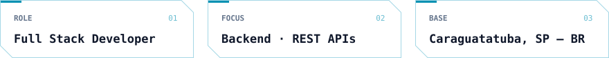</picture>

<picture><source media="(prefers-color-scheme: dark)" srcset="./assets/dark/headings/projects.svg">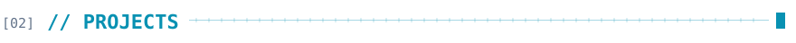</picture>

<a href="https://github.com/jeanbrito-dev/portfolio"><picture><source media="(prefers-color-scheme: dark)" srcset="./assets/dark/projects/portfolio.svg"></picture></a>
<a href="https://github.com/jeanbrito-dev/city-backend"><picture><source media="(prefers-color-scheme: dark)" srcset="./assets/dark/projects/city-backend.svg"></picture></a>
<a href="https://github.com/jeanbrito-dev/city-frontend"><picture><source media="(prefers-color-scheme: dark)" srcset="./assets/dark/projects/city-frontend.svg"></picture></a>
<a href="https://github.com/jeanbrito-dev/ecotube"><picture><source media="(prefers-color-scheme: dark)" srcset="./assets/dark/projects/ecotube.svg"></picture></a>

<picture><source media="(prefers-color-scheme: dark)" srcset="./assets/dark/headings/stack.svg">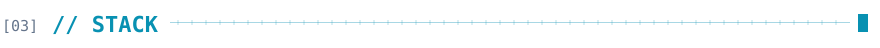</picture>

<picture><source media="(prefers-color-scheme: dark)" srcset="./assets/dark/stack.svg"></picture>

<picture><source media="(prefers-color-scheme: dark)" srcset="./assets/dark/headings/activity.svg">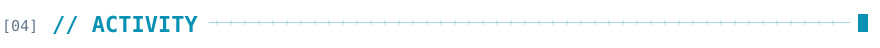</picture>

<picture><source media="(prefers-color-scheme: dark)" srcset="https://streak-stats.demolab.com?user=jeanbrito-dev&locale=en&mode=daily&theme=transparent&hide_border=true&ring=22D3EE&fire=22D3EE&currStreakNum=E5E7EB&sideNums=E5E7EB&currStreakLabel=22D3EE&sideLabels=9CA3AF&dates=6B7280"></picture>

<picture><source media="(prefers-color-scheme: dark)" srcset="./assets/dark/footer.svg"></picture>